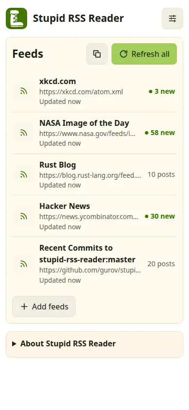
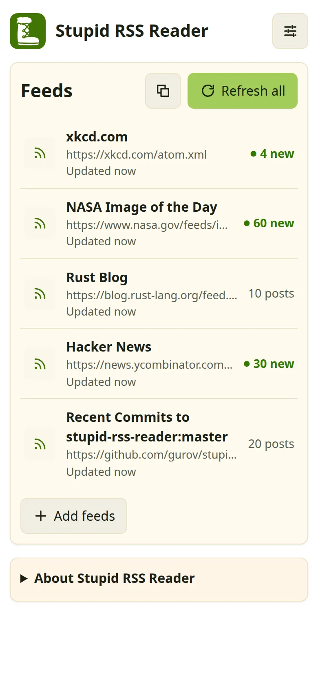
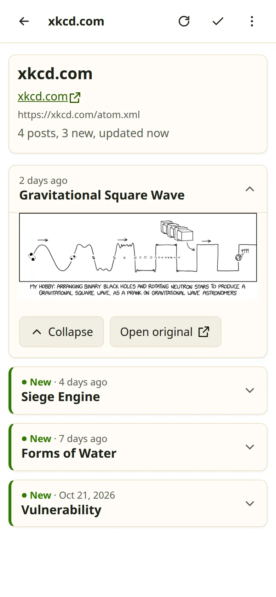
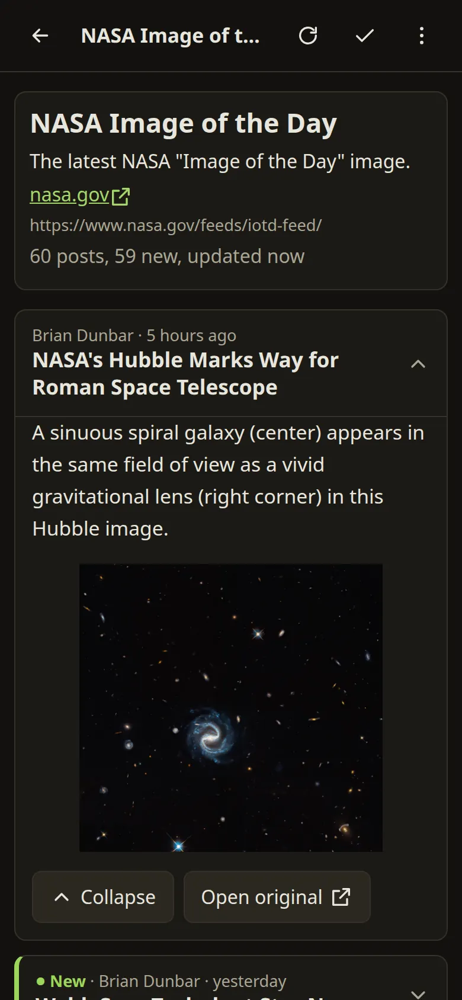

# stupid-rss-reader

I'm tired of different stupid RSS clients and I created own Stupid RSS Reader.

Try it [here](https://gurov.github.io/stupid-rss-reader/)

<p align="center">

</p>

## Features
* RSS 2.0, Atom and RSS 1.0 feeds
* A [Progressive Web App](https://web.dev/explore/progressive-web-apps): install it on your phone or computer, it works offline
* Very simple interface, light and dark
* All user data is stored only in your browser ([IndexedDB](https://developer.mozilla.org/docs/Web/API/IndexedDB_API))
* Plain JavaScript and CSS, no build step, no tracking

## Philosophy
The application does not impose anything, but only executes orders: nothing is
refreshed and nothing is sent until you ask.

## Proxy for RSS

Browsers do not let a page read feeds from other sites (CORS), so the reader loads
feeds through a proxy: `https://rss.bizibah.com/?url={url}` by default. The proxy
returns the feed as is; the reader parses it in your browser.

You can run your own proxy and set it in **Settings → Proxy**. The script, the
contract any proxy must follow, and how to deploy it are in [proxy/](proxy/README.md).

## Privacy

* The proxy sees the address of each feed you refresh and your IP. Ours does not
  keep feed addresses: its log has only the status, the site name and the time.
* Images in an opened post load from the servers of the feed authors. Posts are built
  only when you open them, so nothing from a post loads before that.
* Feeds, posts and settings never leave your browser.

## Security

Every feed and every proxy answer is treated as hostile. The interface is built
without `innerHTML`; post bodies go through [DOMPurify](https://github.com/cure53/DOMPurify)
and come back as DOM nodes; every link and image address is checked. A strict Content
Security Policy with Trusted Types is the second layer. Found a hole? See
[SECURITY.md](SECURITY.md).

## Development

There is nothing to install or build: the app is the `docs/` folder, served by GitHub
Pages as is.

```bash
python3 -m http.server 4200          # from the root of the repository
# open http://localhost:4200/docs/
```

Port 4200 matters: `http://localhost:4200` is an allowed origin of the default proxy.
To run the proxy locally, see [proxy/README.md](proxy/README.md#development).

Tests:

```bash
python3 -m unittest discover -s proxy   # the proxy
tests/run.sh                            # the reader in headless Chrome (Python 3, Node 22+, Chrome)
```

`tests/run.sh` runs the browser tests twice: with the CSP and Trusted Types of the app,
and without them, to check that sanitizing alone holds. `tests/evil-feed.xml` is a feed
full of XSS payloads.

### Releasing

1. Bump `APP_VERSION` in `docs/version.js`: the service worker caches the app by it.
   New files of the app go to `APP_FILES` in `docs/sw.js`.
2. Run the tests, commit, merge to `master`.

## Interface

<p align="center">



</p>

<p align="center">

</p>

The feeds in the screenshots: xkcd, NASA Image of the Day, the Rust Blog, Hacker News and
the commits of this repository.
